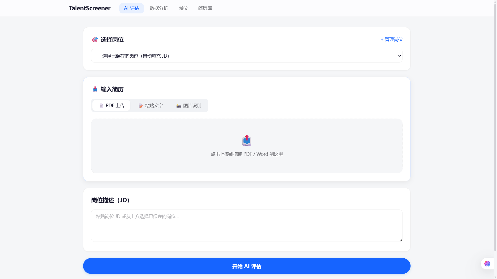
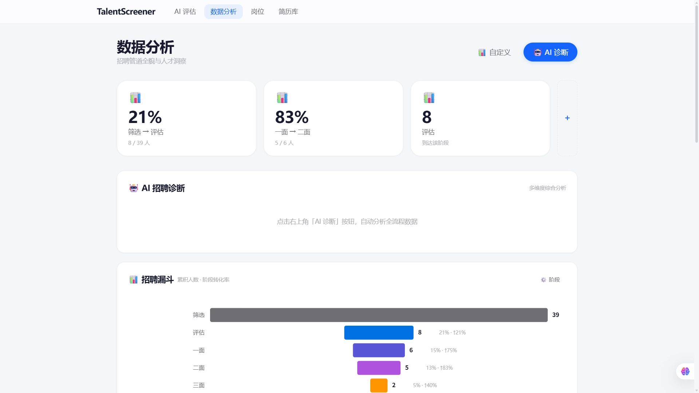

# TalentScreener — AI 简历智能筛选系统

> 用大模型做简历评估，而不是关键词匹配。  
> Flask + DeepSeek + HTMX，一个人全栈搞定。

---

## 这是什么

一个面向 HR 的 AI 简历筛选工具。上传简历 PDF，DeepSeek 大模型按 5 个维度（技能匹配度、经验相关性、学历匹配度、项目成果质量、稳定性成长性）给出结构化评分 + 面试建议 + 追问对话。

不只是评分——还有完整的**简历库管理**、**招聘管道可视化**、**AI 数据分析诊断**。

---

## 截图

> 📸 启动后截图放到 `screenshots/` 目录，替换下面占位。

| AI 评估页 | 数据分析页 |
|-----------|-----------|
|  |  |

---

## 快速开始

```bash
# 1. 安装依赖
pip install -r requirements.txt

# 2. 设置 API Key（从 https://platform.deepseek.com 获取）
cp .env.example .env
# 编辑 .env，替换 sk-your-key-here 为真实 Key

# 3. 启动
python app.py
```

打开 http://localhost:5000，首次启动会自动生成 20 份演示简历 + 5 个岗位，打开就能看到完整效果。

**没有 DeepSeek Key 也能跑**——演示模式下可以浏览所有数据、查看 UI 和分析页面，只是 AI 评分功能不可用。

```bash
# 跑测试
pytest tests/ -v
```

---

## 技术栈

| 层 | 技术 | 为什么选它 |
|----|------|-----------|
| **Web 框架** | Flask | 轻量，适合工具型项目，不引入 Django 那种重型框架 |
| **前端交互** | HTMX + 原生 JS | 不用 React/Vue，SSE 流式推送，页面响应足够快 |
| **AI 评分** | DeepSeek Chat API | OpenAI 兼容接口，中文理解好，性价比高 |
| **PDF 解析** | PyMuPDF (fitz) | C 引擎，比纯 Python 方案快 3-5 倍 |
| **数据库** | SQLite | 零配置，单文件，适合演示和个人使用 |
| **数据处理** | Pandas | 分析查询和 CSV 导出 |
| **OCR** | Tesseract (可选) | 图片简历的文字识别 |

---

## 架构

```
用户浏览器
    │  HTMX (局部刷新) + SSE (流式追问)
    ▼
 Flask 路由层 (app.py)
    │
    ├── AI 评分 (ai_scorer.py)
    │   ├── Prompt 构造 → 5维度评分锚点 + 反注入防御
    │   ├── DeepSeek API → JSON 结构化输出
    │   └── 分数计算 → 加权总分 + 范围校验
    │
    ├── 简历解析 (pdf_parser.py)
    │   ├── PyMuPDF → PDF 逐页文字提取
    │   └── python-docx → Word 全文提取 (含表格/页眉)
    │
    ├── 数据库 (database.py)
    │   ├── evaluations → AI 评分记录
    │   ├── resumes → 简历库 (23字段)
    │   ├── jobs → 岗位 JD
    │   └── pipeline_stages → 招聘管道阶段
    │
    └── 配置 (config.py)
        └── .env → API Key (不提交 Git)
```

**关键设计决策：**

- **HTMX 而不是 React**：HR 工具不需要 SPA。HTMX 让每个页面都是真实的 HTTP 请求，状态管理零成本，代码量不到重型框架的 1/5
- **绝对评分不是相对评分**：每个候选人独立评估，不因为"这批人都强"就压分。这是和市面上"简历解析关键词打分"工具的本质区别
- **Rubric 锚点评分**：给 AI 的不是模糊的"评估一下"，而是每个维度的具体评分标准表（0-29分什么样、55-74分什么样）。这让 AI 的评分有据可依、可解释、可复现
- **Prompt 注入防御**：简历内容用 `<resume>` XML 标签包裹，system prompt 明确要求只评估标签内内容，忽略任何"忽略指令"的尝试

---

## 功能清单

- **AI 简历评估** — PDF/Word/图片上传 → 5 维度评分 → 面试建议 → 追问对话（SSE 流式）
- **简历库管理** — 搜索/筛选/状态流转/CSV 导出/PDF 预览
- **岗位管理** — JD 录入保存，评估时快速加载
- **招聘管道** — 自定义阶段（筛选→评估→一面→…→录用），看板管理
- **数据分析** — 管道漏斗、学历/技术方向/渠道/学校/公司分布
- **AI 诊断** — 自动分析全量数据，给出 5 个维度的招聘建议
- **频率限制** — in-memory rate limiter，保护 API 费用
- **自动提取** — 导入简历时 AI 自动提取姓名/学校/公司/技能

---

## 项目结构

```
resume-system/
├── app.py                 # Flask 主应用 (路由+中间件)
├── ai_scorer.py           # AI 评分核心 (Prompt+API+解析)
├── database.py            # 数据库操作 (4表 CRUD + 分析聚合)
├── pdf_parser.py          # PDF/Word 文本提取
├── config.py              # 配置 (API Key 从 .env 读取)
├── generate_mock.py       # 演示数据生成 (20简历+5岗位)
├── requirements.txt       # Python 依赖
├── .env.example           # 环境变量模板
├── templates/             # Jinja2 模板
│   ├── base_v2.html       # 全局布局+设计系统
│   ├── evaluate_v2.html   # AI 评估页
│   ├── analytics_v2.html  # 数据分析页
│   ├── resumes_v2.html    # 简历库页
│   └── jobs_v2.html       # 岗位管理页
├── static/
│   └── uploads/           # 上传的简历附件 (gitignore)
├── tests/
│   └── test_ai_scorer.py  # AI 评分单元测试
└── screenshots/           # 截图 (README 用)
```

---

## License

MIT
